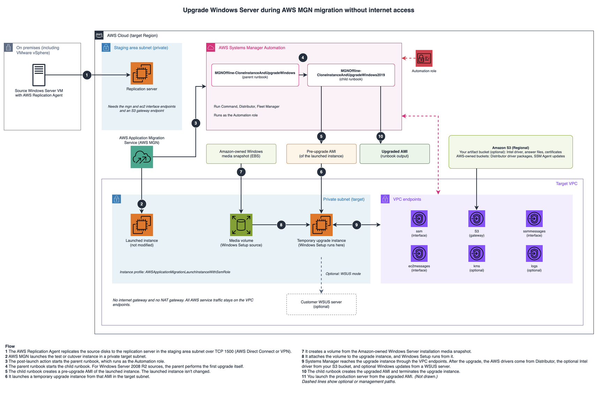

# Upgrade Windows Server during AWS MGN migration without internet access

Customized AWS Systems Manager Automation runbooks that upgrade Windows Server as an
AWS Application Migration Service (AWS MGN) post-launch action in environments that have no internet access.

> **This is sample code, for non-production usage. Work with your security and legal teams to meet your
> organizational requirements before deployment.**

## Overview

AWS MGN provides a predefined Windows OS upgrade post-launch action that runs the Systems Manager runbook
`AWSEC2-CloneInstanceAndUpgradeWindows`. The runbook creates an Amazon Machine Image (AMI) of the launched
instance, upgrades a temporary copy of it in place, and produces an upgraded AMI. The launched instance isn't changed.

Most of that runbook works without internet access, but three post-upgrade tasks require it:

| Task | Why it fails without internet access | Replacement in this sample |
|---|---|---|
| Intel 82599 VF network driver | Downloads from `intel.com` (and, for Windows Server 2008 R2, installs Google Chrome to do so) | Skipped when no Intel 82599 VF adapter is present (all Nitro instance types). Otherwise, downloaded from your Amazon S3 bucket by using a pre-signed URL. |
| AWS NVMe, ENA, and PV drivers | `AWSSupport-UpgradeWindowsAWSDrivers` downloads from `https://s3.amazonaws.com` (us-east-1), which a Regional S3 gateway endpoint doesn't reach | Installed from the AWS Systems Manager Distributor packages `AWSNVMe`, `AwsEnaNetworkDriver`, and `AWSPVDriver` |
| Windows updates | The Windows Update Agent can't reach Microsoft Update | Optional: deferred until after launch (default), or installed from your Windows Server Update Services (WSUS) server |

Two path-specific dependencies are handled the same way: the unattended answer file for Windows Server 2008 R2
sources, and the instance identity certificates for the bring your own license (BYOL) check. When you don't stage
an artifact, the runbooks fall back to the original AWS source, so they also work in environments with internet access.

All other steps of the AWS runbooks are unchanged. Every change is marked with an `# MGN-OFFLINE` comment.

## Architecture



The source file for the diagram is [docs/architecture.drawio](docs/architecture.drawio).

## Repository structure

| Path | Contents |
|---|---|
| `ssm-documents/custom/` | Commented YAML sources of the customized runbooks and the patching document |
| `ssm-documents/aws-original/` | The AWS runbooks that the customized copies are based on (parent version 46, child version 34), for comparison |
| `ssm-documents/dist/` | Deployable minified JSON documents generated by `build.py` |
| `ssm-documents/build.py` | Converts the YAML sources to minified JSON. Systems Manager limits customer-owned documents to 64 KiB. |
| `iam/` | Trust policy and permissions policies for the Automation role, including optional KMS and EC2Rescue policies |
| `docs/` | Architecture diagram |

| Document | Type | Purpose |
|---|---|---|
| `MGNOffline-CloneInstanceAndUpgradeWindows` | Automation | Parent runbook. Use it in the MGN post-launch action. |
| `MGNOffline-CloneInstanceAndUpgradeWindows2019` | Automation | Child runbook that performs the upgrade. Started by the parent. |
| `MGNOffline-ConfigureWsusAndInstallWindowsUpdates` | Command | Optional. Configures WSUS and installs Windows updates on the instance that you launch from the upgraded AMI. |

## Prerequisites

- An AWS account, and permissions to create IAM roles, Systems Manager documents, and AWS MGN post-launch actions.
- AWS MGN initialized in the target AWS Region, with source servers replicating.
- Private target subnets with these VPC endpoints:
  - Interface endpoints `ssm`, `ssmmessages`, and `ec2messages`, with private DNS enabled
  - An S3 gateway endpoint (delivers SSM Agent updates, Distributor packages, and staged artifacts)
  - Optionally, `kms` and `logs`
- If the S3 gateway endpoint uses a custom policy, it must allow the Systems Manager buckets for the Region,
  for example `aws-ssm-<region>` and `aws-ssm-distributor-file-<region>`.
- Source servers with SSM Agent (AWS MGN can install it at launch), Windows PowerShell 3.0 or later, TLS 1.2,
  and more than 20 GB of free space on the boot volume.
- An instance type with at least 2 vCPUs and 4 GiB of memory (8 GiB recommended).
- AWS CLI version 2 and Python 3 with the packages in `requirements.txt`.

## Deployment

The commands use Bash. Set the Region first:

```bash
export AWS_REGION=<region>            # for example, ap-southeast-2
```

### 1. Build the documents

```bash
python3 -m venv .venv
. .venv/bin/activate
pip install -r requirements.txt
python3 ssm-documents/build.py
```

`build.py` prints the size of each document and fails if any document exceeds 64 KiB.

### 2. Create the Systems Manager documents

Create the child runbook before the parent:

```bash
aws ssm create-document --name MGNOffline-CloneInstanceAndUpgradeWindows2019 \
  --document-type Automation --document-format JSON \
  --content file://ssm-documents/dist/MGNOffline-CloneInstanceAndUpgradeWindows2019.json

aws ssm create-document --name MGNOffline-CloneInstanceAndUpgradeWindows \
  --document-type Automation --document-format JSON \
  --content file://ssm-documents/dist/MGNOffline-CloneInstanceAndUpgradeWindows.json

aws ssm create-document --name MGNOffline-ConfigureWsusAndInstallWindowsUpdates \
  --document-type Command --document-format JSON \
  --content file://ssm-documents/dist/MGNOffline-ConfigureWsusAndInstallWindowsUpdates.json
```

To update a document later, run `aws ssm update-document --document-version '$LATEST'` with the new content,
and then make the new version the default with `aws ssm update-document-default-version`.

### 3. Create the Automation role

Fill in the policy placeholders. The rendered files are written to `rendered/`, which Git ignores.

```bash
ACCOUNT_ID=$(aws sts get-caller-identity --query Account --output text)
ROLE_NAME=MGNOffline-WindowsUpgradeAutomationRole
INSTANCE_PROFILE_ROLE=AWSApplicationMigrationLaunchInstanceWithSsmRole
ARTIFACT_BUCKET=<artifact-bucket-name>   # leave as-is if you don't stage artifacts

mkdir -p rendered
for f in iam/*.json; do
  sed -e "s/<ACCOUNT_ID>/${ACCOUNT_ID}/g" -e "s/<REGION>/${AWS_REGION}/g" \
      -e "s/<AUTOMATION_ROLE_NAME>/${ROLE_NAME}/g" \
      -e "s/<INSTANCE_PROFILE_ROLE_NAME>/${INSTANCE_PROFILE_ROLE}/g" \
      -e "s/<ARTIFACT_BUCKET>/${ARTIFACT_BUCKET}/g" "$f" > "rendered/$(basename "$f")"
done
```

If you don't stage artifacts in Amazon S3, remove the `ReadPreStagedArtifacts` statement:

```bash
python3 - <<'EOF'
import json
p = "rendered/automation-role-policy.json"
d = json.load(open(p))
d["Statement"] = [s for s in d["Statement"] if s["Sid"] != "ReadPreStagedArtifacts"]
json.dump(d, open(p, "w"), indent=2)
EOF
```

Create the role and attach the policy:

```bash
aws iam create-role --role-name "${ROLE_NAME}" \
  --assume-role-policy-document file://rendered/automation-role-trust-policy.json

aws iam put-role-policy --role-name "${ROLE_NAME}" --policy-name MGNOfflineWindowsUpgrade \
  --policy-document file://rendered/automation-role-policy.json
```

Optional policies:

- `automation-role-policy-optional-kms.json` — if EBS volumes or the artifact bucket use a customer managed
  AWS KMS key. Replace `<EBS_KMS_KEY_ARN>` and `<ARTIFACT_BUCKET_KMS_KEY_ARN>` in the rendered file, and remove
  the statement that you don't need.
- `automation-role-policy-optional-ec2rescue.json` — only for the fallback that runs if SSM Agent doesn't come
  online on the upgrade instance. Without it, that fallback fails instead of running.

The identity that starts the runbook must be allowed to pass this role (`iam:PassRole` on the role to
`ssm.amazonaws.com`).

### 4. (Optional) Stage artifacts in Amazon S3

Most migrations don't need any artifacts. You need them only in these cases:

| Artifact | When you need it | Parameter |
|---|---|---|
| Intel Ethernet driver for the target OS (`Wired_driver_<version>_x64.zip`) | The instance type uses Intel 82599 VF enhanced networking (C3, C4, D2, I2, R3, M4 except m4.16xlarge) | `IntelDriverS3Key`, `IntelDriverSha256` |
| Intel driver for Windows Server 2012 R2 (`Release_28.2.1.zip`) | Windows Server 2008 R2 sources on Intel 82599 VF instances | `IntelDriver2012R2S3Key`, `IntelDriver2012R2Sha256` |
| `generic-Datacenter-Autounattend.xml` and `generic-Standard-Autounattend.xml` | Windows Server 2008 R2 sources | `AnswerFileS3Prefix` |
| `imds_certificates.json` | BYOL instances | `ImdsCertificatesS3Key` |

Download the files on a computer that has internet access:

```bash
mkdir -p mgn-artifacts && cd mgn-artifacts
curl -fLO https://downloadmirror.intel.com/931389/Wired_driver_31.3_x64.zip
curl -fLO https://downloadmirror.intel.com/787127/Release_28.2.1.zip
curl -fLO https://awsec2-server-upgrade-prod.s3.us-west-1.amazonaws.com/generic-Datacenter-Autounattend.xml
curl -fLO https://awsec2-server-upgrade-prod.s3.us-west-1.amazonaws.com/generic-Standard-Autounattend.xml
curl -fLO https://s3.us-west-2.amazonaws.com/aws.portingassistant.dotnet.datastore/certificates/imds_certificates.json
shasum -a 256 *.zip
```

Check the [Intel download page](https://www.intel.com/content/www/us/en/download/19372/intel-network-adapter-driver-for-windows-server-2019.html)
for the latest driver version. Upload the files to a bucket in the same Region, with Block Public Access and
default encryption turned on. Grant `s3:GetObject` to the Automation role only. Don't add an `aws:SourceVpce`
condition to the bucket policy, because the runbook checks the objects from the Automation service before the
instance downloads them.

### 5. Configure the AWS MGN post-launch action

In the AWS MGN console, open the source server (or the post-launch template) and do the following:

1. Activate post-launch actions, set **Deployment** to **Test and cutover**, and turn on **Install the Systems
   Manager agent**. Turn off predefined actions that you don't need; some of them also require internet access.
2. In the EC2 launch template, use a private target subnet without a public IP, an instance type with at least
   8 GiB of memory, and a root volume that leaves more than 20 GB free. Choose **Set as default version**.
3. Add a custom action with the document `MGNOffline-CloneInstanceAndUpgradeWindows`. The console fills in the
   document description, which exceeds the 256-character limit for action descriptions; replace it with a
   short description.
4. Set the parameters:

| Parameter | Value |
|---|---|
| `InstanceId` | Dynamic value `ec2.InstanceId` |
| `IamInstanceProfile` | `AWSApplicationMigrationLaunchInstanceWithSsmRole` |
| `SubnetId` | A private target subnet |
| `TargetWindowVersion` | The target version, for example `2022`. The default is `2025`. |
| `AutomationAssumeRole` | The ARN of the Automation role |
| `WindowsUpdateMode` | `Skip` (default), `WSUS`, or `WindowsUpdate` |
| `WsusServerUrl` | Required for `WSUS`, for example `http://wsus.example.internal:8530` |
| Artifact parameters | Only if you staged artifacts in step 4 |

## Parameters added by this sample

| Parameter | Default | Description |
|---|---|---|
| `WindowsUpdateMode` | `Skip` | `Skip`: no updates during the upgrade; patch after launch. `WSUS`: install updates from `WsusServerUrl`. `WindowsUpdate`: original behavior; requires internet access. |
| `WsusServerUrl` | Empty | WSUS server URL. |
| `ArtifactBucket` | Empty | S3 bucket in the same Region that holds staged artifacts. |
| `IntelDriverS3Key`, `IntelDriverSha256` | Empty | Intel driver package for the target OS and its SHA-256 hash. |
| `IntelDriver2012R2S3Key`, `IntelDriver2012R2Sha256` | Empty | Parent runbook only. Intel driver package for the intermediate 2012 R2 upgrade. |
| `AnswerFileS3Prefix` | Empty | Parent runbook only. Prefix, ending in `/`, of the staged answer files. |
| `ImdsCertificatesS3Key` | Empty | Staged `imds_certificates.json` for the BYOL licensing check. |
| `ChildDocumentName` | `MGNOffline-CloneInstanceAndUpgradeWindows2019` | Parent runbook only. Name of the customized child runbook. |

## Run and validate

1. Launch a test instance in AWS MGN. The post-launch action starts after the instance launches and SSM Agent is installed.
2. In Systems Manager Automation, follow the parent and child executions. An upgrade can take up to 2 hours.
   Review the output of every step, because failures in non-critical steps don't stop the run.
3. Launch an instance from the AMI in the parent's `ImageId` output, and confirm the OS version, the driver
   versions, Windows activation, and your applications.
4. If `WindowsUpdateMode` was `Skip`, install updates on that instance:

```bash
aws ssm send-command --document-name MGNOffline-ConfigureWsusAndInstallWindowsUpdates \
  --instance-ids <instance-id> \
  --parameters WsusServerUrl=http://wsus.example.internal:8530
```

Leave out `WsusServerUrl` if Group Policy already configures WSUS.

## Limitations

- The runbook supports the same upgrade paths as `AWSEC2-CloneInstanceAndUpgradeWindows`. It doesn't support
  domain controllers, failover clusters, Windows desktop operating systems, or servers with Remote Desktop
  Services roles. Upgrades to Windows Server 2025 require a Nitro-based source instance.
- The result is a new AMI. You launch the final server from it.
- The customized runbooks are based on specific AWS runbook versions. When AWS updates the runbooks, merge the
  changes into `ssm-documents/custom/`. Compare against the latest AWS version with
  `aws ssm get-document --name AWSEC2-CloneInstanceAndUpgradeWindows --document-format YAML`.
- The runbooks are close to the 64 KiB document size limit.
- Tested with a Windows Server 2019 Datacenter to 2022 upgrade, license-included, on a Nitro-based instance in
  ap-southeast-2. The Windows Server 2008 R2, BYOL, WSUS, and Intel 82599 VF paths weren't tested.
- The files in `ssm-documents/aws-original/` were downloaded in ap-southeast-2. AWS fills in the Region in one
  script line (`$region = "..."`); the customized copies read the Region from `{{ global:REGION }}` instead.

## Clean up

Delete the AMIs and snapshots that you no longer need, the Systems Manager documents, the Automation role, and
the artifact bucket.

```bash
aws ssm delete-document --name MGNOffline-CloneInstanceAndUpgradeWindows
aws ssm delete-document --name MGNOffline-CloneInstanceAndUpgradeWindows2019
aws ssm delete-document --name MGNOffline-ConfigureWsusAndInstallWindowsUpdates
aws iam delete-role-policy --role-name MGNOffline-WindowsUpgradeAutomationRole --policy-name MGNOfflineWindowsUpgrade
aws iam delete-role --role-name MGNOffline-WindowsUpgradeAutomationRole
```

## Security

See [CONTRIBUTING](CONTRIBUTING.md#security-issue-notifications) for more information.

## License

This library is licensed under the MIT-0 License. See the [LICENSE](LICENSE) file.
